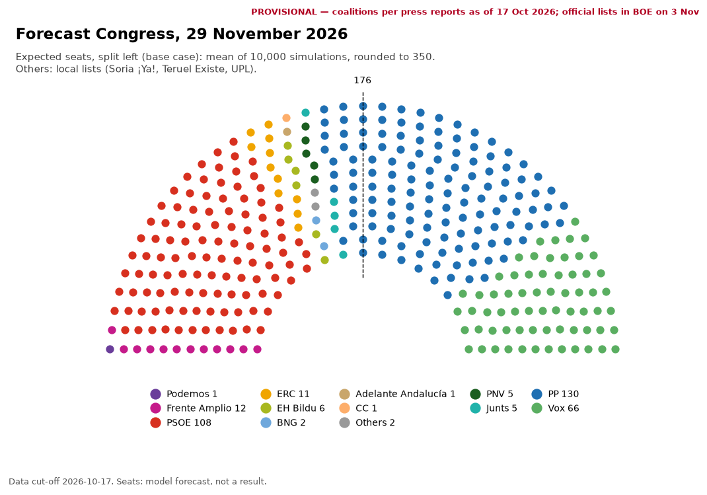
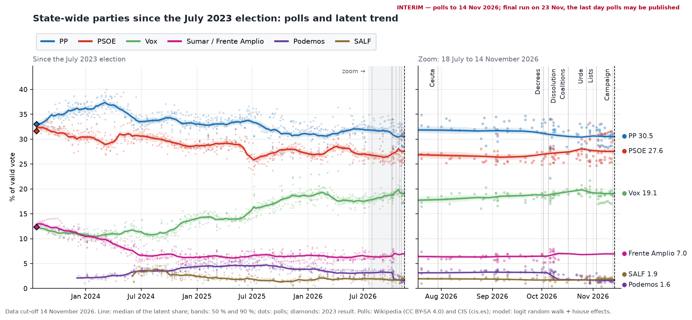
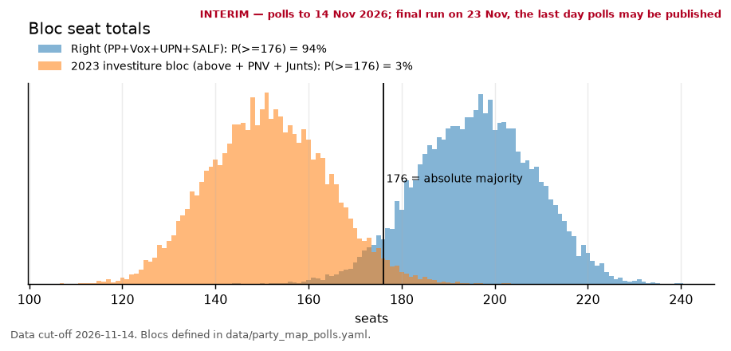
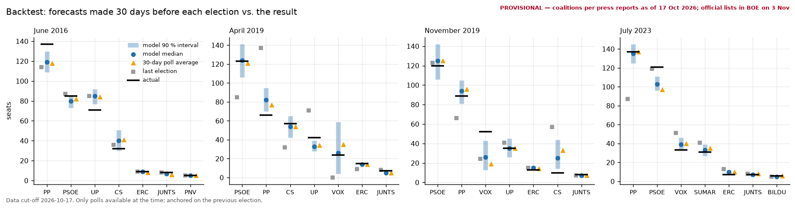

# Forecasting the 29 November 2026 Spanish general election

**A Bayesian poll-aggregation and seat-projection model, with a four-election backtest.**

> **INTERIM — polls to 14 November 2026; the final run will use the polls published up to 23 November,
> the last day the law allows.** Everything below is conditional on polls published up to the data
> cut-off, **14 November 2026**, the day after the campaign opened and two weeks before polling day.
> Re-run `make all` to refresh.

The 2023 Congreso election produced PP 137 seats, PSOE 121, Vox 33, Sumar 31. On 5 October 2026 the
Cortes were dissolved and a snap election called for 29 November. This repository turns the public
polling record since 2023 (659 polls from 40 pollsters and CIS-based series, the CIS straight from
cis.es) and the
official results 1977-2023 into a probabilistic forecast for that election. It then checks how the
same pipeline would have done 30 days before the 2016, April 2019, November 2019 and 2023 elections.
It started life as an undergraduate Excel/SPSS dossier on Spanish electoral volatility; the
descriptive part of that dossier is reproduced in `reports/figures/`.

## Headline result

**On 29 November**, the model gives PP 30.5 % of the vote (90 % interval 25.0-36.6), PSOE 27.5 %
(22.5-33.2), Vox 19.0 % (15.6-23.1), the Frente Amplio space (Frente Amplio plus Compromís-Front
Valencià, the Sumar lineage) 6.9 % (5.7-8.6) and Podemos 1.6 % (1.3-2.1) where it has its own list.
Seats follow the lists proclaimed on 3 November. The **base case** is the left as registered: Frente
Amplio and Podemos apart, with Podemos absent from the ten provinces where it joined other lists. The
**sensitivity** is one Frente Amplio + Podemos list everywhere, keeping 0.83 of the sum as Unidos
Podemos did in 2016.


*Expected seats on 29 November, base case: each party's mean over 10,000 simulations, rounded so they
add up to 350. No single simulation need look exactly like this; the 90 % ranges are in the table below.
PP + Vox reach 196 here. "Frente Amplio" includes Compromís-Front Valencià. "Others" are local lists
(Soria ¡Ya!, Teruel Existe, UPL). Merged-left version:
[`hemicycle_29n_merged.png`](reports/figures/hemicycle_29n_merged.png); interactive version with both:
`docs/index.html`.*

| party | vote at cut-off | seats if held at cut-off, 90 % | seats on 29 Nov, split left (base) | seats on 29 Nov, merged left |
|---|---|---|---|---|
| PP | 30.5 % | 122 - 135 | 128 (105 - 151) | 128 (105 - 151) |
| PSOE | 27.6 % | 103 - 116 | 109 (89 - 131) | 109 (89 - 131) |
| Vox | 19.1 % | 62 - 74 | 67 (52 - 85) | 68 (52 - 85) |
| Frente Amplio + Compromís-Front Valencià | 7.0 % | 8 - 13 | 10 (6 - 16) | 10 (6 - 17) |
| Podemos | 1.6 % | 0 - 1 | 1 (0 - 1) | (in Frente Amplio) |
| ERC | 2.6 % | 8 - 12 | 10 (7 - 13) | 10 (7 - 13) |
| EH Bildu / PNV / Junts | 1.4 / 0.9 / 1.3 % | 6-8 / 4-6 / 3-6 | 7 / 5 / 5 | 7 / 5 / 5 |
| BNG / CC / Adelante Andalucía | 0.9 / 0.4 / about 1.3 % | 1-2 / 1 / 0-5 | 2 / 1 / 1 | 2 / 1 / 1 |

| event (29 Nov) | split left | merged left |
|---|---|---|
| PP + Vox (+ UPN, SALF) reach 176 seats | 94 % | 95 % |
| PP largest party | 78 % | 78 % |
| PSOE largest party | 22 % | 22 % |
| 2023 investiture bloc (PSOE, FA, Podemos, ERC, Bildu, BNG, CC, AA, PNV, Junts) reaches 176 | 3 % | 3 % |
| PP alone reaches 176 | < 1 % | < 1 % |

**What changed since the 17 October run** (PP 131, PSOE 107, Vox 66; PP + Vox majority 93 %).
- **The published PP-PSOE gap is narrower, but little of that is movement in the last four weeks.**
  The 17 October run read PP 31.1 / PSOE 26.9 at its cut-off; this one reads PP 30.5 / PSOE 27.6. With
  today's polls and rules the model reads 17 October itself as PP 30.6 / PSOE 27.4, so the change since
  then is PP -0.1, PSOE +0.2, Vox -0.3. The rest is a re-reading: new studies and pollsters, and the
  rule changes below, moved the reference against which house effects are measured. The two were not
  separated.
- **The bloc arithmetic did not move.** PP + Vox are at 49.6 % of the vote and a 94 % chance of a
  majority; PP is the largest party in 78 % of simulations (80 % before). Two weeks from the vote
  these figures rest almost entirely on the election-day polling error, not on drift.
- **The CIS pre-election study** (45,074 interviews, PSOE 33.3 / PP 25.5) enters with its usual house
  effect (-5.1 for PP, +4.1 for PSOE), so its official estimate moves the average little. The raw data
  underneath did move: our own recall-weighted reading of the October barometer is PP 28.4 /
  PSOE 27.6, against PP 30.6 / PSOE 25.7 in September, and two outside re-estimates of the
  pre-election study put PSOE first.
- **CIS-based series count as one pollster.** Ten of the 39 series are readings of CIS raw data (the
  official estimate, ours and eight third-party re-estimates). They now share one vote when house
  effects are centred. With one vote each the cut-off read PP 30.2 / PSOE 27.8.
- **Pollsters disagree more than in October**: the PP lead runs from 7.7 points (Data10) to -2.9
  (SW Demoscopia, a new firm with no record). The 40dB daily tracking has it at 1.3.
- **Party supply as proclaimed.** Polls now ask about the registered lists. Podemos is measured only
  where it runs alone (3.1 % to 1.6 %, most of the fall a change of definition) and wins 0-1 seats;
  the 50/50 guess about its Catalan voters is gone. ERC reads 2.6 % with Podemos on its lists.
- **Trackers count once.** Daily and cumulative releases of one pollster with overlapping fieldwork
  are no longer separate polls (659 listed, 583 used).
- The election-day error was re-calibrated on the refitted backtest: 11.5 % of each party's share
  (13.3 % before).

## Three figures


*Latent vote share (median, 50 % and 90 % bands) and every poll since July 2023. Numbered lines: Ceuta
(30 Jul), decrees rejected (2 Oct), dissolution (5 Oct), coalitions closed and Colau announced (17 Oct), Urda
rail crash (28 Oct), lists proclaimed (3 Nov), campaign starts (13 Nov). The step in Podemos in mid-October is the
switch to the registered ballots.*


*Seat totals for the two competing blocs on 29 November, base case (split left).*


*What the same pipeline would have said 30 days before each of the last four elections, against the result.*

## Methods

| component | choice | code |
|---|---|---|
| Results | Ministerio del Interior fixed-width files, all 16 elections, 52 provinces; D'Hondt reproduces the official 2019 and 2023 seats exactly (tested) | `mir.py`, `seats.py`, `tests/` |
| Polls | Wikipedia opinion-polling wikitext (CC BY-SA 4.0), rowspan/colspan/reference-aware parser; third-party re-estimations of CIS data kept as their own pollsters; one release per overlapping fieldwork window of a pollster | `wiki_polls.py`, `build_data.py` |
| CIS | straight from cis.es: the official estimate for 99 studies since 2016 (PDFs, all cycles), and our re-estimate from the microdata for the current cycle (CIS weight, 2023 recall, likely voters; not backtested). Series built from one survey share its sample size | `cis.py`, `cis_microdata.py` |
| Party mapping | per-election Ministry codes and poll labels to canonical ids and blocs; Frente Amplio + Compromís-Front Valencià continue the Sumar series | `data/party_map_*.yaml`, `docs/party_mapping.md` |
| Aggregator | weekly logit-scale random walk per party, anchored on the 2023 result; level shifts where the party supply changed; hierarchical house effects centred on publishing pollsters, CIS-based series as one; binomial + excess noise; NUTS (nutpie), 4 x 1,000 draws | `model.py` |
| Seats | proportional swing from 2023 provincial shares + log-normal provincial noise (sd 0.13); regional-poll layer (CEO, Sociómetro, CIS subsamples); 29N ballots as proclaimed (Podemos absent from ten provinces, the Valencian part of the Frente Amplio space set from polls, UPN with PP); 3 % threshold; 10,000 simulations | `seats.py`, `regional.py`, `project_seats.py` |
| Backtest | refit 30 days before 2016, Apr-2019, Nov-2019, 2023 with only earlier polls; regional layer only for Catalonia 2023 (CEO) | `backtest.py` |
| Election day | 2 weeks of random-walk drift plus an election-day error calibrated on the backtest (11.5 % of each party's share); mean reversion tested and rejected | `forecast.py` |
| Descriptive | turnout, Laakso-Taagepera ENP, Pedersen volatility split within/between blocs, bloc matrix, provincial fragmentation | `indices.py`, `descriptive.py` |

## Backtest scorecard (mean over the four elections, forecasts made 30 days out)

| method | vote MAE (pp) | vote CRPS (pp) | 90 % vote coverage | seat MAE | 90 % seat coverage | Brier (two events) |
|---|---|---|---|---|---|---|
| **this model** | **1.04** | **0.89** | 40 % | **4.2** | 73 % | **0.06** |
| 30-day poll average | 1.17 | 1.17 | n/a | 4.9 | n/a | 0.12 |
| last election result | 2.59 | 2.59 | n/a | 11.0 | n/a | 0.25 |

The backtest was refitted on 14 November with the two new rules, which apply to every cycle:
overlapping tracker releases count once (10-17 % fewer polls per election) and CIS-based series are
one pollster. The scores barely changed against the 17 October version (vote MAE 1.03, seat MAE 4.2,
Brier 0.05): neither rule buys accuracy in the backtest; they are there because the alternative
double-counts. The regional layer could only be backtested for Catalonia in 2023, where it cut the
2023 seat MAE from 3.5 to 3.1. That gain is in-sample: the layer's error settings were calibrated on
the same election.

In words:

* The model beats both baselines on every point-accuracy score, but the margin over a plain 30-day
  poll average is small. Most of the value is in the house-effect correction and the intervals.
* **The intervals are too narrow.** At 30 days out the 90 % vote intervals covered only 40 % of the
  outcomes. In July 2023 every pollster underestimated PSOE by about 5 pp, and the model gave a 68 %
  chance to a PP + Vox majority that did not happen. Polls share their errors, which is why the
  election-day projection adds an error term (11.5 % of each party's share, the smallest value that
  would have restored 90 % coverage).
* Where it fails: sudden late movements (Vox doubling in the last month of the November 2019
  campaign; Cs collapsing) and any election with a common polling bias.

Full per-election table: `outputs/backtest_scorecard.csv` and `outputs/backtest_details.csv`.

## What drives the uncertainty

Seat standard deviation for PP when sources are added one at a time, base case
(`outputs/uncertainty_decomposition.csv`): the posterior at the cut-off 2.9 seats, plus provincial
swing noise 4.0, plus two weeks of drift 4.5, plus election-day polling error 13.8. With two weeks to
go the shared polling error is nearly all of it. For the regional parties near the 3 % district
threshold, provincial swing noise and the regional surveys matter most.

## Descriptive findings (the upgraded dossier)

* Fragmentation peaked in 2019 (effective number of parties 5.8 by votes) and fell back to 4.1 in 2023.
* Volatility is mostly *within* blocs: the two largest shocks (1982, 42 pp; 2015, 32 pp) moved voters
  between parties of the same side. The left/right balance is much more stable than any party's share.
* The peripheral vote is 7 % nationally but 22-54 % in the Basque, Navarrese and Catalan provinces,
  where national polls say least and investitures are decided.

## How to run

Requires [uv](https://docs.astral.sh/uv/) (it fetches Python 3.12). No C compiler needed.

```bash
uv sync --extra dev
make all          # data -> tests -> descriptive -> aggregate -> seats -> backtest -> forecast -> report
```

Individual phases: `uv run electoral build-data | descriptive | aggregate | seats | backtest | forecast | report`.
`build-data` downloads the CIS PDFs and microdata (about 100 studies) and the CEO microdata (about
330 MB) into the gitignored `data/raw/`. The aggregator takes about eight minutes; the backtest about
ten (per-cycle results are cached in `outputs/backtest/`). Seeds, dates, party supply scenarios
and regional settings live in `config.yaml`; every output is stamped with the cut-off.

Outputs for other projects: `outputs/poll_average_daily.csv` (daily latent share per party with
quantiles), documented in `docs/outputs.md`. Interactive version: `docs/index.html`.

## Repository

```
config.yaml            dates, seed, sources, model, party-supply scenarios, regional layer, backtest
data/party_map_*.yaml  party lineage and bloc definitions (edit here to disagree)
data/regional/         regional tables extracted from PDFs, with their URLs
data/processed/        tidy datasets + DATA_DICTIONARY.md + DATA_QUALITY.md + cis_studies.csv + regional_polls.csv
src/electoral/         mir, wiki_polls, cis, cis_microdata, regional, build_data, model, seats, backtest, forecast, report
tests/                 D'Hondt (incl. exact reproduction of official seats), parsers, CIS, regional layer, model, 29N ballots
outputs/               poll average, house effects, seat draws, scorecard, diagnostics (traces gitignored)
reports/figures/       all figures; docs/methods_note.md is the write-up; docs/index.html the interactive page
docs/context_29N_2026.md  the political context, party supply and sources for the 29N re-run
```

## Limitations

* **Interim run.** The final run will use the polls published up to 23 November. Still missing here:
  the microdata of the CIS pre-election study (not on cis.es on 14 Nov, so it enters as the official
  estimate only) and any CEO wave after 5 October.
* **Who counts as a pollster shapes the PP-PSOE gap.** House effects are centred on the average
  pollster, one vote each, with the ten CIS-based series as one. That average is a choice: with one
  vote per series the gap is 2.4 points instead of 2.9, and a plain average of recent private polls
  gives PP about five, because prolific pollsters weigh more in it. The majority probability is not
  sensitive to this; "largest party" is.
* **Where the Frente Amplio space wins its seats is partly assumed.** Its Valencian part comes from
  the seven pollsters that list Compromís-Front Valencià apart (10-23 % of the space); the rest keeps
  Sumar's 2023 geography, which probably understates Más Madrid. The model gives the space 10 seats
  where the CIS and most pollsters give 11 to 15 for a similar vote.
* **Common polling error is the dominant risk** and is handled by an inflation term calibrated on
  four elections (twenty party-election residuals). With two weeks to go it is nearly all the uncertainty.
* **The regional layer rests on thin evidence.** Its weights were calibrated on one election (Catalonia
  2023, four parties), and the CEO overstated ERC by 5 points then. The Sociómetro asks about the Basque
  Parliament, so its swing since 2024 is assumed to carry over. CC and Navarre have no regional source.
* **Our CIS microdata series is not backtested**, and Adelante Andalucía enters the seat model at its
  recent poll median (about 1.3 %) rather than through the aggregator.
* **No demographic model.** The campaign's fight for young voters is not modelled: polls show them
  leaning right with a large gender gap, voting less and deciding late (`docs/context_29N_2026.md`
  §8.5). Late movement is covered only by the election-day error term.
* **Parties are modelled independently** on the logit scale; the seat model renormalises.
* Turnout is not modelled; shares are of the valid vote.

## Data sources and licences

* Ministerio del Interior, *infoelectoral.interior.gob.es*, files `02YYYYMM_TOTA.zip`. Reuse under
  Ley 37/2007 and RD 1495/2011. *Origen de los datos: Ministerio del Interior.*
* English Wikipedia, "Opinion polling for the [2016 / April 2019 / November 2019 / 2023 / 2026]
  Spanish general election" and the 2019-2022 sub-pages, CC BY-SA 4.0.
* Centro de Investigaciones Sociológicas, cis.es, CC BY 4.0: estimate PDFs, technical sheets and
  microdata. *Fuente de los datos: Centro de Investigaciones Sociológicas.*
* Centre d'Estudis d'Opinió (Generalitat de Catalunya), open microdata of the Baròmetre d'Opinió Política.
* Basque Government, Sociómetro Vasco and the official 2024 Basque Parliament results (euskadi.eus).

## Author

Kristiyan Pandas, [github.com/kristiyanpanda](https://github.com/kristiyanpanda). BA Sociology, MSc Data
Analytics. Interactive version of the results: `docs/index.html`.

## Resumen en español

**PROVISIONAL (intermedio): encuestas hasta el 14-11-2026; la versión final usará las publicadas hasta el
23 de noviembre, último día permitido por la ley.**
Modelo bayesiano de agregación de encuestas (paseo aleatorio semanal en escala logit, efectos de casa
por encuestadora, anclado en el resultado de 2023), con el CIS tomado directamente de cis.es (estimación
oficial y reestimación propia con microdatos) y una capa de encuestas regionales (CEO, Sociómetro, CIS).
Proyección de escaños por D'Hondt en las 52 circunscripciones con las candidaturas proclamadas el 3 de
noviembre y 10.000 simulaciones. Con datos hasta el 14-11-2026, el 29 de noviembre el PP obtendría
105-151 escaños (mediana 128), el PSOE 89-131 (109) y Vox 52-85 (67); PP+Vox superarían los 176 con una
probabilidad del 94 %, y el PP sería primera fuerza con un 78 %. La distancia entre PP y PSOE es de 2,9
puntos (4,2 en la versión del 17 de octubre), aunque casi todo ese cambio es una relectura de los
mismos datos y no un movimiento de las últimas cuatro semanas; la suma de PP y Vox no ha cambiado. El
backtest sobre 2016, abril y noviembre de 2019 y 2023 muestra un error medio de 1,0 puntos en voto,
pero intervalos demasiado estrechos por el sesgo común de las encuestas; por eso la proyección al día de
la elección incorpora un error electoral calibrado, que a dos semanas de la votación domina la incertidumbre.
