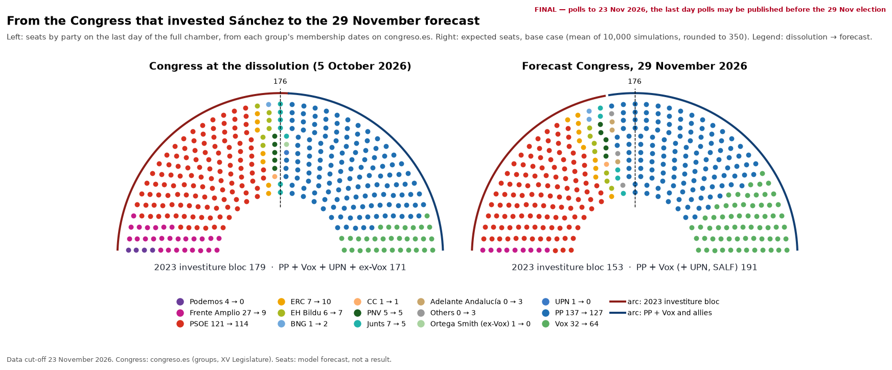
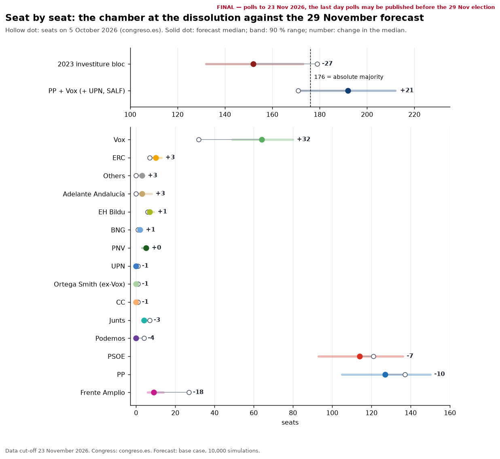
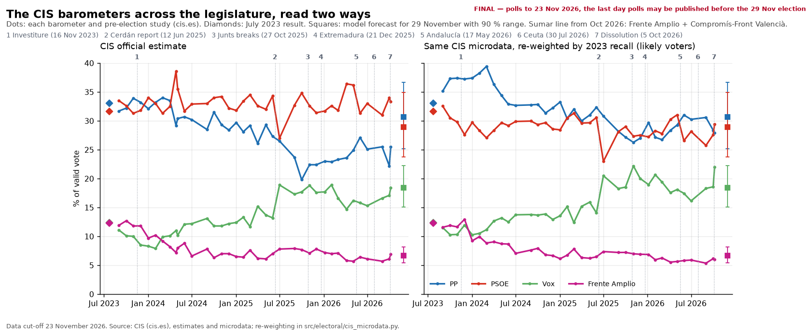

# From the Congress that invested Sánchez to 29 November: a seat-by-seat comparison

*Versión en español: [`spanish version/congreso_29N.md`](../spanish%20version/congreso_29N.md).*

> **A forecast, not a result.** The 29 November figures come from the model's final run (polls to
> 23 Nov 2026, base case with the left on separate lists, 10,000 simulations). The Congress comes from
> congreso.es. The "why" sections are the author's reading of the CIS, the polls and the press. They
> are not part of the model and do not establish cause.

Reproduce with `electoral chamber` (`src/electoral/chamber.py`). It downloads the membership start and
end dates of the nine groups of the XV Legislature, rebuilds the chamber and compares it with the
simulations. Tables: `outputs/chamber_29n.csv` and `outputs/chamber_blocs_29n.csv`.

## 1. How the Congress is organised and where the numbers come from

- **350 seats** in 52 districts (the provinces plus Ceuta and Melilla), allocated by D'Hondt with a 3 %
  threshold *in each province*. There is no national threshold, so 1.5 % concentrated in Catalonia
  wins more seats than 6 % spread across Spain.
- **Parliamentary groups** (Standing Orders, art. 23) need 15 deputies, or 5 deputies with 15 % of the
  vote where the list stood or 5 % nationally. Everyone else sits in the **Mixed Group**. Groups are
  therefore not parties: at the dissolution the Mixed Group held Podemos, BNG, CC, UPN, Compromís (Més)
  and an ex-Vox deputy.
- **Investiture** (Constitution, art. 99) needs an absolute majority (176) in the first vote, or a
  simple majority (more yes than no) in the second, 48 hours later. Sánchez was invested on 16 Nov
  2023 by **179 votes to 171**.
- **After the dissolution** (decree published 6 Oct 2026), the official site shows only the members of
  the Diputación Permanente as the "current composition" (PP 54, PSOE 49, Vox 12, Sumar 12, and 2 each
  for ERC, Junts, Bildu, PNV and the Mixed Group, full members and substitutes). The full chamber is
  rebuilt from each group's "Altas y bajas" tab: 426 membership spells with start and end dates. Each
  deputy counts for the **party of their list**, not their group. Both snapshots add up to 350 and
  reproduce the 179-171 investiture vote (checked in `tests/test_chamber.py`).

### What changed in the chamber between the investiture and the dissolution

| date | change | effect on the groups |
|---|---|---|
| 5 Dec 2023 | Podemos's 5 deputies leave the Sumar group | Sumar 31 → 26, Mixed 3 → 8 |
| 26 Jan 2024 | Lilith Verstrynge (Podemos) resigns; the next on the Sumar list replaces her | Sumar 27, Podemos 4 |
| 27 Feb 2024 | Ábalos, dropped by the PSOE (Koldo case), moves to the Mixed Group | PSOE 120 |
| 24 Oct 2024 | Errejón resigns his seat (replaced from the Sumar list) | no change |
| 12/16 Jun 2025 | Cerdán resigns after the UCO police report and gives up his seat (replaced from the PSOE list) | no change |
| 3 Jul 2025 | Àgueda Micó (Més-Compromís) leaves Sumar for the Mixed Group | Sumar 26 |
| 27 Oct 2025 | **Junts breaks the investiture pact** in Perpignan (backed by 87 % of its members) | the bloc loses 7 votes in practice |
| 28 Jan 2026 | Ábalos gives up his seat from prison; it returns to the PSOE (Ana González Herdaro) | PSOE 121 |
| 17 Jul 2026 | Ortega Smith, expelled from Vox in March, leaves the Vox group for the Mixed Group | Vox 32 |
| 2 Oct 2026 | PP, Vox, Junts and UPN vote down the housing decrees | |
| 6 Oct 2026 | Dissolution; election on 29 Nov | |

**At the dissolution, by party:** PP 137, PSOE 121, Vox 32, Sumar/Frente Amplio 27 (26 in the group
plus Micó), ERC 7, Junts 7, Bildu 6, PNV 5, Podemos 4, BNG 1, CC 1, UPN 1, Ortega Smith (ex-Vox) 1.
The investiture bloc still added up to **179 on paper**, but **172 without Junts**, which had voted
with the opposition since October 2025. The government had been in a working minority for a year.

***Figure A.*** *Left: Congress on 5 Oct 2026, the last day of the full chamber. Right: expected seats
on 29 Nov (mean over the simulations, rounded to 350). The arcs mark the 2023 investiture bloc and the
right.*

## 2. The result in one sentence

**The bloc that invested Sánchez falls from 179 to 152 seats (90 %: 132-173) and reaches 176 in only
3.5 % of simulations. PP + Vox rise from 171 to 192 (171-212) and reach 176 in 90 %.** That is a swing
of about 25 seats between the blocs. Most of the movement happens **inside** the right: Vox doubles
(+32) while the PP *loses* 10. The state-wide left (PSOE + Frente Amplio + Podemos) falls from 152 to
124, and most of that is the collapse of the Sumar space (−18), not the PSOE (−7).

| bloc | investiture 2023 | dissolution 2026 | 29 Nov (median, 90 %) | P(≥ 176) |
|---|---|---|---|---|
| 2023 investiture bloc | 179 | 179 | 152 (132-173) | 3.5 % |
| … without Junts | 172 | 172 | 148 (128-169) | 1.6 % |
| … plus Adelante Andalucía | 179 | 179 | 155 (135-176) | 5.7 % |
| PP + Vox (+ UPN, SALF) | 171 | 171 | 192 (171-212) | 90 % |

**The second ballot does not rescue the bloc.** A simple majority only needs more yes than no votes,
but PP + Vox hold 175 or fewer in just 10 % of simulations, and even then the investiture bloc plus
Adelante Andalucía outnumbers them in only 7 %. What disappears is a PP government without Vox: PP +
Junts + PNV + CC + UPN reach 176 in 0.1 % of cases. If the right governs, it governs with Vox. The only
majority with neither Vox nor the 2023 bloc is a PSOE + PP grand coalition (100 %), which nobody has
proposed.

***Figure B.*** *Seats at the dissolution (hollow dot) against the forecast median (solid dot) and its
90 % range. The number is the change in the median.*

## 3. What the CIS barometers show across the legislature

Every barometer comes straight from cis.es (`data/processed/cis_studies.csv`) and is read two ways: the
**official estimate**, and our **re-estimate from the same microdata**, weighted to the 2023 recalled
vote and kept to respondents certain to vote (method in `src/electoral/cis_microdata.py`). The
difference matters. In September 2026 (study 3577) the sample recalled 39.0 % PSOE in 2023 (real 31.7)
and 24.4 % PP (real 33.1). The official estimate does not correct that, which is why it always puts the
PSOE first.

***Figure C.*** *The CIS barometer by barometer, from September 2023 to the November 2026
pre-election study (3584, 45,074 interviews).*

| CIS, % of valid vote | Sep 2023 (3420) | Jul 2025 (3517) | Sep 2026 (3577) | pre-election (3584) | 2023 result |
|---|---|---|---|---|---|
| PP: official / re-estimated | 31.7 / 35.1 | 26.5 / 30.8 | 25.5 / 30.6 | 25.5 / 27.9 | 33.1 |
| PSOE: official / re-estimated | 33.5 / 32.6 | 27.0 / 23.0 | 31.0 / 25.7 | 33.3 / 29.4 | 31.7 |
| Vox: official / re-estimated | 11.1 / 11.5 | 18.9 / 20.5 | 16.6 / 18.3 | 18.4 / 22.0 | 12.4 |
| Sumar → Frente Amplio + FV: official / re-estimated | 11.9 / 11.6 | 7.8 / 7.4 | 5.7 / 5.4 | 6.9 / 6.0 | 12.3 |

Three phases show in both readings:

1. **August 2023 - May 2025: slow erosion.** The re-estimated PP is above 35 % in 2023-24 and drifts to
   31-33 %. Vox climbs steadily from 11 to 15 %. Sumar splits after Podemos leaves and falls from
   11-12 % to 6-7 %. The PSOE holds at 28-30 %.
2. **June-July 2025: the Cerdán case.** It is the one sharp break in the series. After the UCO report
   (12 Jun 2025) the re-estimated PSOE drops from 30.6 to 23.0 % and Vox rises from 14.1 to 20.5 %. The
   PSOE recovers by the autumn (28-29 %), but **Vox never falls back below 16 %**: the socialist scandal
   fed Vox, not the PP.
3. **October 2025 - October 2026: no majority.** Junts's break, regional defeats (Extremadura, Aragón,
   Andalucía), the Ceuta crisis and the failed decrees. The PSOE swings between 26 and 31 %, the PP
   recovers to 30-31 % by mid-2026 and Vox moves between 16 and 22 %.

**The blunt reading:** since summer 2025 no version of the CIS, not even the official one, has given the
investiture bloc an edge over PP + Vox like the one it had in 2023. The official estimate keeps the
PSOE first because it does not weight by recall. Weighted, the same data put PP and PSOE level at about
28-30 % and Vox at 18-22 %. **What decides the majority is not who wins between PP and PSOE, it is how
big Vox is.**

## 4. Party by party: how much changes and why

Seats: dissolution → 29 Nov forecast (median, 90 % range). Vote: 2023 → forecast.

### Vox: 32 → 64 (49-80), +32. Vote 12.4 % → 18.5 %
- **Why it rises.** (1) *Other parties' corruption:* the CIS jump of July 2025 coincides with the Cerdán
  case, and Vox, more than the PP, collected the punishment. (2) *Immigration:* the Ceuta crisis (July
  2026, about 72,000 entries) made immigration the top problem in private polls (40dB: 45.9 %). Vox is
  seen as the most competent party on it (27 %, against 18.4 % for the PSOE and 13.9 % for the PP).
  (3) *Normalisation:* it governs with the PP in Extremadura and Aragón, and doubled its seats in
  Aragón (to 14). (4) *The young:* in the CIS pre-election study it leads direct vote under 45; among
  18-24s it has 22 %, against 19 % for the PSOE and 12 % for the PP.
- **Why it converts into so many seats.** At 18 % Vox wins a seat in nearly every province, including
  the 3-5-seat ones where it missed out in 2023. In November 2019, 15.1 % gave it 52.
- **What could prove this wrong.** Vox slipped in the last week of polls (median 18.8 → 18.0) while the
  PSOE rose. Ortega Smith's exit and his letter against Abascal do not show up in the data. There is
  also a measurement question: our re-estimate of study 3584 has Vox at 22 %, the poll average at
  18.5 %. If the truth is nearer the re-weighted CIS, the top of the range (80) is plausible.

### PP: 137 → 127 (105-150), −10. Vote 33.1 % → 30.7 %
- **Why it falls even as the right wins.** Communicating vessels: the re-estimated PP goes from 35-39 %
  in 2023-24 to 28-31 % in 2026, and nearly all of the loss goes to Vox. Feijóo won the opposition, not
  the bloc. His final appeal to PSOE voters to "lend" him their vote so he would not depend on Vox
  admits the problem.
- **What holds it up.** It is the largest party in 71 % of simulations, and at 30 % the system still
  rewards it in small provinces. The press gave the 19 Nov debate to Feijóo, but the polls did not move
  the PP afterwards.
- **What could prove this wrong.** A late tactical swing from Vox to the PP. The polls do not show it:
  the PP was flat in the last week.

### PSOE: 121 → 114 (93-136), −7. Vote 31.7 % → 29.0 %
- **Why it falls.** (1) *A chain of scandals:* the Koldo/Ábalos case (Supreme Court sentence in
  September 2026: 24 years for Ábalos), Cerdán, and pending cases. (2) *The cost of governing in a
  minority:* without Junts since October 2025, the housing decrees fell on 2 Oct 2026 and the PSOE
  called the election from defeat. (3) *A dreadful regional cycle:* Extremadura 25.8 % (its worst ever),
  Aragón 24.4 %, Andalucía 22.8 %. (4) *Government performance:* the Urda rail crash (28 Oct 2026, 69
  dead) and Puente's resignation in the pre-campaign.
- **Why it does not collapse.** Socialist voters drift to **abstention**, not to the PP: in September,
  28 % of the CIS undecided had voted PSOE in 2023 (8.5 % PP). That vote can come back during a
  campaign, and in the last week the PSOE recovered about two points (median 26.5 → 28.4 %), mostly
  from Frente Amplio and Vox. A concentrated left vote wins the PSOE seats at its partners' expense, not
  the bloc's.
- **What could prove this wrong.** 2023, when every pollster underestimated the PSOE by about 5 points.
  Our re-weighted CIS puts it first (29.4 against 27.9), and three pollsters (40dB, SW Demoscopia,
  Cluster17) have it level or ahead. The top of the range (136) is that scenario. Even then, a bigger
  PSOE at its partners' expense does not change the majority.

### Sumar → Frente Amplio (+ Compromís-Front Valencià): 27 → 9 (6-14), −18. Vote 12.3 % → 6.7 %
- **The biggest collapse in the chamber.** The space that held 31 seats in 2023 arrives broken: Podemos
  left in December 2023, Errejón resigned in October 2024, Més-Compromís left the group in 2025, Yolanda
  Díaz stepped aside in 2026, and Frente Amplio is the space's fourth brand in ten years (with Colau as
  candidate). The re-estimated CIS takes it from 11.6 % to 6.0 %.
- **Why it costs so many seats.** D'Hondt punishes 6 % nationally: outside Madrid, Barcelona, Valencia
  and a few large provinces it does not clear the effective threshold. Going from 12 % to 6.7 % cuts
  the seats by about two-thirds, not by half.
- **What could prove this wrong.** The official CIS gives Frente Amplio 7-11 seats and Compromís-Front
  Valencià 4-6 (11-17 together), and the pollsters 11-15. Our model inherits Sumar's 2023 geography and
  may under-read Más Madrid (a limitation noted in the README).

### Podemos: 4 → 0 (0-1), −4. Vote 1.4 % where it runs alone
- It broke with Sumar in December 2023 and reached almost 5 % in the re-estimated CIS (December 2024), but
  stands at 1.1 % in the pre-election study. Joint primaries with Frente Amplio failed, so it runs
  alone in 42 districts and in coalitions in Canarias, Valencia and Baleares; in Catalonia its
  candidates are on ERC's lists. **Note:** a Podemos candidate elected on an ERC or Compromís-Front
  Valencià list counts for that party in the model.

### ERC: 7 → 10 (7-13), +3. Vote 1.9 % → 2.6 %
- The Catalan CEO poll gave it 10-11 Congress seats, Rufián was the fourth preferred leader in the
  September CIS (4.6 %, ahead of Ayuso and Díaz), and it carries Podemos on its lists. The CIS codes
  "ERC-Podemos" as one option (3.1 %, 10-14 seats). It is the only clear gain inside the investiture
  bloc: more seats in 92 % of simulations.

### Junts: 7 → 4 (3-7), −3. Vote 1.6 % → 1.2 %
- **It broke with Sánchez** on 27 Oct 2025 to avoid being overtaken by Aliança Catalana, which already
  led it in the CEO's Catalan-parliament question. It voted against the housing decrees and triggered
  the election. AC is not running on 29 Nov and about a quarter of its voters would go to Junts, but
  that is not enough. The "3 %" trial opened on 23 Nov. It loses seats in 95 % of simulations.
- **For the bloc this is a double loss:** Junts has left it and also shrinks.

### PNV: 5 → 5 (3-6), 0 · EH Bildu: 6 → 7 (5-9), +1
- The Basque Sociómetro (April 2026) had them almost level (PNV 35.3 %, Bildu 32.2 %). The fight is for
  the last seat in Bizkaia and Araba, and Bildu gains in Gipuzkoa and Navarra from voters leaving the
  state-wide left. The PNV voted against the second housing decree: still in the bloc, but less tied
  to it.

### BNG: 1 → 2 (1-3), +1
- It carries the strength of the 2024 Galician election (pooled Galician CIS subsamples, about 920
  respondents). A second seat, most likely in A Coruña, comes up in 90 % of simulations.

### CC: 1 → 0 (0-1) · UPN: 1 → 0 · Ortega Smith: 1 → 0
- **CC** lives on the last seat in Las Palmas or Santa Cruz de Tenerife with 0.3-0.5 % nationally and
  keeps it in 45 % of simulations. It voted for Feijóo in September 2023 and for Sánchez in November,
  so it is a swing vote more than a bloc vote.
- **UPN** runs jointly with the PP in Navarra: any seat it wins counts as PP in the model. It is not a
  real loss for the right.
- **Ortega Smith** is not on any 29 Nov list in the sources checked. His seat came from Vox's list.

### Adelante Andalucía: 0 → 3 (0-8) · Others (Soria ¡Ya!, Teruel Existe, UPL): 0 → 3 (1-4)
- Adelante Andalucía won 9.6 % in the May 2026 Andalusian election (+6) and the CIS gives it 3-4 seats.
  It did not vote in the 2023 investiture (it was not in Congress), but it would hardly back PP + Vox.
  Even counting it, the bloc reaches 155. Its range is wide because the aggregator does not identify
  it (a fixed share spread over Andalusia's eight provinces).
- The "others" are rural-depopulation lists. If they win seats, they are the only swing seats outside
  the blocs.

## 5. Conclusion

1. **29 November is not lost by the PSOE but by its partners.** The PSOE gives up about 7 seats. The
   space to its left gives up 22 (Frente Amplio −18, Podemos −4), and Junts leaves the bloc and
   shrinks. The 2023 arithmetic, Sánchez plus six partners, does not exist in 96 % of simulations.
2. **The right wins through Vox, not the PP.** The PP would have fewer seats than in 2023. The PP + Vox
   majority rests on Vox doubling its group, which makes Vox indispensable for any Feijóo investiture:
   without it, PP + Junts + PNV + CC + UPN reach 176 in 0.1 % of cases.
3. **The risk to this reading is 2023.** In the 5 % of simulations most favourable to the left, the
   right falls back to 171 seats, exactly its 2023 figure. That needs a polling error in the PSOE's
   favour as large as the one then. It is not impossible (it happens in one simulation in ten), but it
   is not the central case.

## Sources

- **Congress:** composition and membership changes of the groups, XV Legislature,
  [congreso.es](https://www.congreso.es/es/grupos/composicion-en-la-legislatura) (accessed 23 Nov 2026);
  reproducible download in `src/electoral/chamber.py`.
- **CIS:** barometers and pre-election study 3584, estimates and microdata from
  [cis.es](https://www.cis.es) (`data/processed/cis_studies.csv`).
- **Changes in the chamber:** Ortega Smith leaves the Vox group
  ([El Español](https://www.elespanol.com/espana/politica/20260717/ortega-smith-anuncia-deja-vox-congreso-pasa-grupo-mixto-no-veo-representado/1003744325225_0.html),
  [Ara](https://en.ara.cat/politics/ortega-smith-leaves-the-vox-parliamentary-group-in-congress-and-moves-to-the-mixed-group_25_5801415.html));
  expulsion in March ([El Español](https://www.elespanol.com/espana/politica/20260306/vox-expulsa-definitivamente-ortega-smith-formacion-aparta-jose-angel-antelo-direccion-nacional/1003744158136_0.html));
  Micó to the Mixed Group ([VilaWeb](https://www.vilaweb.cat/noticies/mes-compromis-trenca-sumar-agueda-mico-grup-mixt/),
  [El Independiente](https://www.elindependiente.com/espana/2025/06/24/sumar-distingue-la-salida-de-agueda-mico-al-grupo-mixto-de-la-de-podemos-en-2023-no-es-transfuguismo/));
  Ábalos gives up his seat ([Público](https://www.publico.es/politica/abalos-renuncia-escano-congreso.html),
  [Noticias de Navarra](https://www.noticiasdenavarra.com/politica/2026/01/28/psoe-recupera-escano-renuncia-abalos-10630708.html));
  Cerdán ([El Salto](https://www.elsaltodiario.com/psoe/santos-cerdan-dimite-todos-cargos-entrega-acta-diputado),
  [Deia](https://www.deia.eus/politica/2025/06/16/santos-cerdan-informa-supremo-dejara-9765500.amp.html));
  Junts's break ([Última Hora](https://www.ultimahora.es/noticias/comunidades/2025/10/27/2499801/ejecutiva-junts-acuerda-por-unanimidad-romper-psoe.html),
  [Ara, members' vote](https://es.ara.cat/politica/afiliados-junts-avalan-romper-sanchez-87-apoyo_1_5546088.html)).
- **Campaign context, polls and regional studies (CEO, Sociómetro):** see
  [`context_29N_2026.md`](context_29N_2026.md), §1-§9, with its sources.
