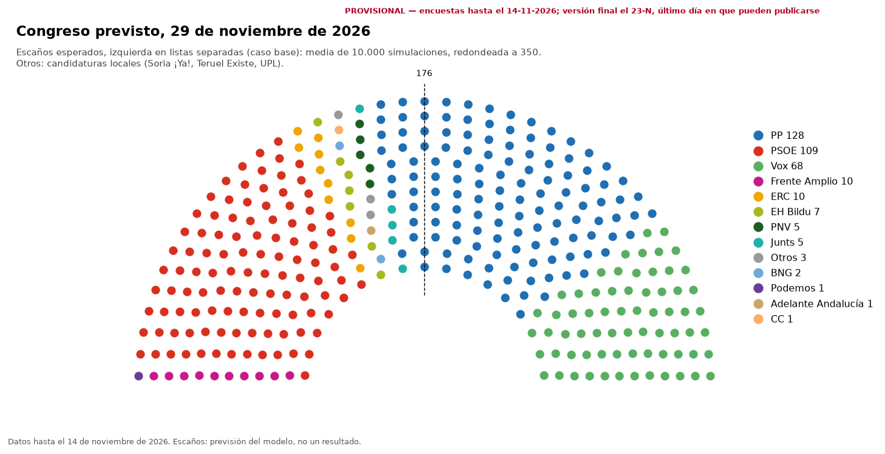
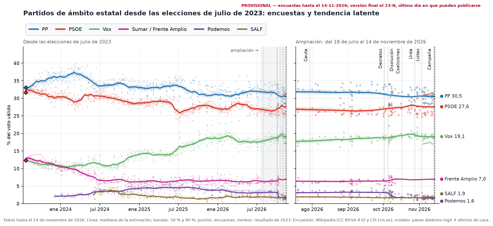
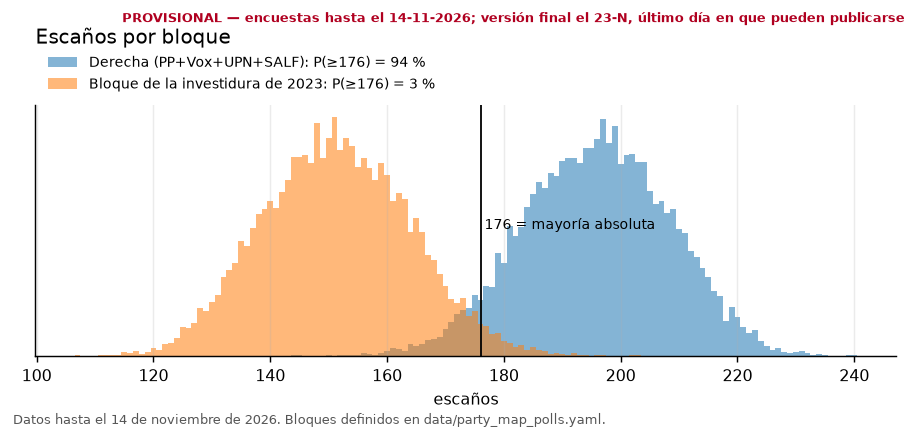
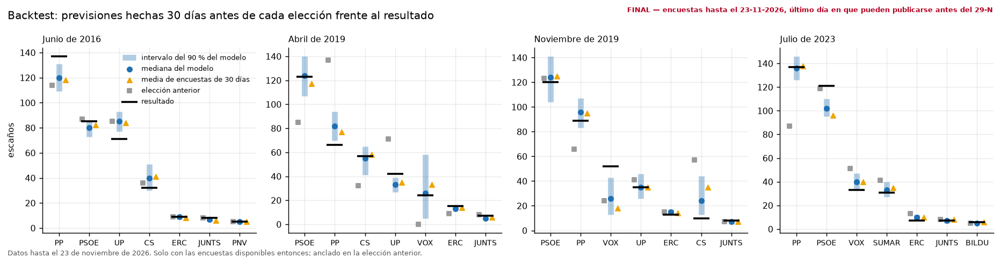
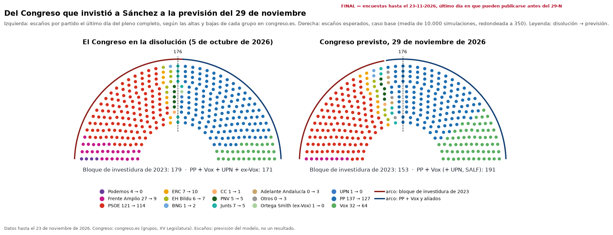
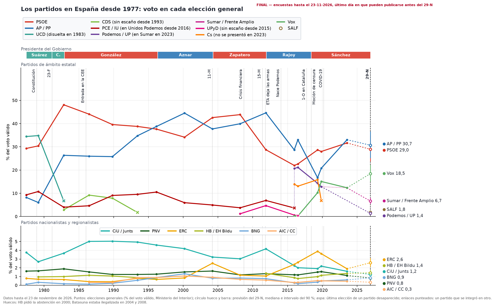

# Previsión de las elecciones generales del 29 de noviembre de 2026

**Modelo bayesiano de agregación de encuestas y proyección de escaños, con un backtest sobre cuatro elecciones.**

*English version: [`README.md`](../README.md).*

**Página interactiva:** https://kristiyanpanda.github.io/spain-election-forecast/es/ (inglés: [aquí](https://kristiyanpanda.github.io/spain-election-forecast/)).

> **FINAL — encuestas hasta el 23 de noviembre de 2026, último día en que la ley permite publicarlas
> antes de las elecciones del 29 de noviembre.** Todo lo que sigue depende de las encuestas publicadas
> hasta el cierre de datos, el **23 de noviembre de 2026**, seis días antes de la votación. Es la última
> versión antes de las elecciones; la versión provisional del 14 de noviembre está archivada en
> `outputs/archive/2026-11-14/`.

Las elecciones al Congreso de 2023 dieron 137 escaños al PP, 121 al PSOE, 33 a Vox y 31 a Sumar. El 5 de
octubre de 2026 se disolvieron las Cortes y se convocaron elecciones anticipadas para el 29 de noviembre.
Este repositorio convierte el registro público de encuestas desde 2023 (737 encuestas de 45 encuestadoras
y series basadas en el CIS, con el CIS tomado directamente de cis.es) y los resultados oficiales de
1977-2023 en una previsión probabilística de esas elecciones. Después comprueba cómo habría funcionado el
mismo procedimiento 30 días antes de las elecciones de 2016, abril de 2019, noviembre de 2019 y 2023.
Nació como un trabajo de grado en Excel y SPSS sobre la volatilidad electoral en España; la parte
descriptiva de aquel trabajo se reproduce en `figures/`.

## Resultado principal

**El 29 de noviembre**, el modelo da al PP el 30,7 % del voto (intervalo del 90 %: 25,1-36,7), al PSOE el
29,0 % (23,7-34,9), a Vox el 18,5 % (15,1-22,3), al espacio del Frente Amplio (Frente Amplio más
Compromís-Front Valencià, la línea que viene de Sumar) el 6,7 % (5,4-8,1) y a Podemos el 1,4 % (1,1-1,7)
donde presenta lista propia. **PP y Vox alcanzan la mayoría en el 90 % de las simulaciones; el PP es
primera fuerza en el 71 %.** El PSOE ha recortado parte de la distancia en la última semana de campaña,
pero no lo bastante para cambiar la aritmética de bloques. Los escaños siguen las candidaturas
proclamadas el 3 de noviembre. El **caso base** es la izquierda tal como se ha registrado: Frente Amplio
y Podemos por separado, con Podemos ausente de las diez provincias donde se integró en otras listas. El
análisis de **sensibilidad** es una lista única de Frente Amplio y Podemos en todas las provincias, que
conserva 0,83 de la suma, como Unidos Podemos en 2016.


***Figura 1. Congreso previsto, 29 de noviembre de 2026.*** *Escaños esperados, caso base: la media de
cada partido en 10.000 simulaciones, redondeada para que sumen 350. Ninguna simulación tiene por qué ser
exactamente así; los intervalos del 90 % están en la tabla de abajo. PP y Vox suman aquí 191. «Frente
Amplio» incluye a Compromís-Front Valencià. «Otros» son candidaturas locales (Soria ¡Ya!, Teruel Existe,
UPL). Versión con lista única de la izquierda:
[`hemicycle_29n_merged.png`](figures/hemicycle_29n_merged.png). En la página interactiva (`index.html`)
este gráfico es un pactómetro: se marca el voto de cada partido en una investidura (sí, abstención o no)
y se ve el recuento frente a los 176 y en qué proporción de las simulaciones sale adelante ese pacto.*

| partido | voto al cierre de datos | escaños si se votara al cierre, 90 % | escaños el 29-N, listas separadas (base) | escaños el 29-N, lista única |
|---|---|---|---|---|
| PP | 30,7 % | 121 - 134 | 127 (105 - 150) | 127 (105 - 150) |
| PSOE | 29,0 % | 108 - 121 | 114 (93 - 136) | 114 (93 - 137) |
| Vox | 18,5 % | 59 - 70 | 64 (49 - 80) | 64 (49 - 81) |
| Frente Amplio + Compromís-Front Valencià | 6,7 % | 7 - 11 | 9 (6 - 14) | 9 (5 - 14) |
| Podemos | 1,4 % | 0 - 1 | 0 (0 - 1) | (en Frente Amplio) |
| ERC | 2,6 % | 8 - 12 | 10 (7 - 13) | 10 (7 - 13) |
| EH Bildu / PNV / Junts | 1,4 / 0,8 / 1,2 % | 6-8 / 4-6 / 3-6 | 7 / 5 / 4 | 7 / 5 / 4 |
| BNG / CC / Adelante Andalucía | 0,9 / 0,3 / en torno a 1,5 % | 2-3 / 0-1 / 0-8 | 2 / 0 / 3 | 2 / 0 / 3 |

| suceso (29-N) | listas separadas | lista única |
|---|---|---|
| PP + Vox (+ UPN, SALF) alcanzan 176 escaños | 90 % | 90 % |
| PP, primera fuerza | 71 % | 71 % |
| PSOE, primera fuerza | 29 % | 29 % |
| El bloque de la investidura de 2023 (PSOE, FA, Podemos, ERC, Bildu, BNG, CC, AA, PNV, Junts) alcanza 176 | 6 % | 5 % |
| El PP alcanza 176 en solitario | < 1 % | < 1 % |

**Qué ha cambiado desde la versión provisional del 14 de noviembre** (PP 128, PSOE 109, Vox 67; mayoría
de PP + Vox, 94 %; PP primera fuerza, 78 %).
- **El PSOE ha subido en la última semana, sobre todo a costa de Vox.** Al cierre, el modelo lee PP
  30,7 / PSOE 29,0 / Vox 18,5, frente a PP 30,5 / PSOE 27,6 / Vox 19,1 publicados el 14 de noviembre.
  Las encuestas en bruto dicen lo mismo: la mediana, entre encuestadoras, de la última publicación de
  cada una pasa de PP 31,5 / PSOE 26,5 / Vox 18,8 (1-13 nov) a PP 31,4 / PSOE 28,4 / Vox 18,0
  (17-22 nov). El PP se mantiene, el PSOE sube unos dos puntos y bajan Vox y la izquierda del PSOE. El
  debate Sánchez-Feijóo (19 nov) cae en mitad de ese periodo y las encuestas posteriores no muestran un
  cambio de tendencia.
- **Parte del cambio es una relectura, no un movimiento.** Con todos los datos, el modelo lee ahora el
  propio 14 de noviembre como PP 30,8 / PSOE 28,6 / Vox 18,4. El agregador es un suavizador: las
  encuestas posteriores informan la estimación de semanas anteriores, y las publicadas desde el 14 de
  noviembre también reestiman el efecto de casa de cada encuestadora. Desde el 14 de noviembre releído,
  el movimiento es PP -0,1, PSOE +0,4, Vox +0,1. No se han separado más las dos partes.
- **La aritmética de bloques se ha movido, pero poco.** PP y Vox bajan del 49,6 % al 49,2 % del voto y
  del 94 % al 90 % de probabilidad de mayoría; el total esperado del bloque de la derecha es de 191
  escaños. La probabilidad de que el PSOE sea primera fuerza sube del 22 % al 29 %. A seis días de la
  votación, estas cifras dependen casi por completo del error de las encuestas el día de la elección.
- **Ya están los microdatos del preelectoral del CIS.** cis.es ha publicado los microdatos del estudio
  3584 (45.074 entrevistas). Nuestra reestimación, ponderada por recuerdo de voto y con votantes
  probables, da PSOE 29,4 / PP 27,9 / Vox 22,0: como las reestimaciones externas, el PSOE primero y Vox
  muy por encima del 18,4 oficial. No mueve la media: un reajuste sin ella da las mismas cifras con un
  decimal, porque las series basadas en el CIS forman una familia cuyos efectos de casa la absorben.
- **Las encuestadoras discrepan sobre la distancia, no sobre el bloque.** En las últimas publicaciones la
  ventaja del PP va de 6,8 puntos (Hamalgama Métrica) a -2,6 (SW Demoscopia); 40dB, Ipsos, Metroscopia y
  More in Common la dejan por debajo de un punto, y la mayoría de las demás entre 2,5 y 5. PP y Vox suman
  entre el 47 y el 53 % en todas salvo SW Demoscopia (45,7).
- Solo cambios de datos: la página de Wikipedia trasladó sus tablas de 2023-24 a una subpágina (que ahora
  también se descarga; no se ha perdido ninguna fila), y las etiquetas de las candidaturas del 29-N en
  el CIS (Frente Amplio y sus listas conjuntas, Compromís-Front Valencià, UPN-PP) se han añadido a la
  correspondencia de los microdatos. No ha cambiado el código del modelo, así que el backtest y su error
  del día de la elección del 11,5 % son los del 14 de noviembre. No hay oleada nueva del CEO desde el
  14 de octubre.

## Tendencia, bloques y backtest


***Figura 2. Partidos de ámbito estatal desde las elecciones de julio de 2023: encuestas y tendencia
latente.*** *Estimación de voto (mediana, bandas del 50 % y del 90 %) y todas las encuestas. Izquierda:
el ciclo completo; la franja sombreada es el periodo ampliado a la derecha. Derecha: los últimos cuatro
meses, con los acontecimientos fechados: la crisis fronteriza de Ceuta (30 de julio), el rechazo de los
decretos en el Congreso (2 de octubre), la disolución (5 de octubre), el cierre de coaliciones y el
anuncio de Colau (17 de octubre), el accidente ferroviario de Urda (28 de octubre), la proclamación de
candidaturas (3 de noviembre), el inicio de la campaña (13 de noviembre) y el debate Sánchez-Feijóo
(19 de noviembre). La línea discontinua es el
cierre de datos. El escalón de Podemos a mediados de octubre es el paso a las papeletas registradas.*


***Figura 3. Escaños por bloque el 29 de noviembre.*** *Suma de escaños de los dos bloques en
competencia, caso base (listas separadas en la izquierda).*


***Figura 4. Backtest.*** *Lo que habría dicho el mismo procedimiento 30 días antes de cada una de las
cuatro últimas elecciones, frente al resultado.*

## Del Congreso actual al 29-N

La cámara que invistió a Sánchez (179 votos contra 171, 16-11-2023), reconstruida con las altas y bajas
de cada grupo en congreso.es, frente a la previsión. **En la disolución, el bloque de la investidura de
2023 seguía sumando 179 sobre el papel (172 sin Junts, que rompió el pacto en octubre de 2025); para el
29-N se prevé en 152 escaños (132-173), con un 3,5 % de probabilidad de llegar a 176.** PP + Vox pasan de
171 a 192 (171-212). El vuelco ocurre dentro de cada bloque: Vox +32 y PP −10 en la derecha; Frente
Amplio −18, PSOE −7, Podemos −4 y Junts −3 frente a ERC +3 entre los socios de 2023. Las razones,
partido a partido y contrastadas con todos los barómetros del CIS de la legislatura (estimación oficial
y nuestros microdatos reponderados), están en [`congreso_29N.md`](congreso_29N.md).


***Figura 5.*** *Izquierda: escaños por partido el 5-10-2026, último día del pleno completo
(congreso.es). Derecha: escaños esperados el 29-N. Cambios escaño a escaño:
[`seat_change_29n.png`](figures/seat_change_29n.png); el CIS a lo largo de la legislatura:
[`cis_legislature.png`](figures/cis_legislature.png). Se reproduce con `electoral chamber`.*

## Los partidos desde 1977

El porcentaje del voto válido de cada partido en las dieciséis elecciones generales desde 1977
(Ministerio del Interior), siguiendo a cada partido a través de sus cambios de nombre, con la previsión
del 29-N al final. Se ven tres sistemas de partidos. **UCD** ganó las dos primeras elecciones (34-35 %)
y se hundió al 6,8 % en 1982, el año del 48,1 % del PSOE. Desde entonces **PSOE y AP/PP** se turnaron:
entre los dos llegaron al 83,8 % en 2008. La crisis de 2008 y el 15-M lo rompieron: en 2015 los dos
bajaron al 50,7 %, con la entrada de **Podemos** (20,7 %) y **Cs** (13,9 %), y en abril de 2019 al
45,4 %. **Vox** pasó del 0,2 % en 2016 al 15,1 % en noviembre de 2019. Cs perdió dos tercios de su voto
aquel noviembre y no se presentó en 2023; el espacio a la izquierda del PSOE pasó de IU a Unidas
Podemos, después a Sumar y ahora a Frente Amplio y Podemos por separado. La previsión devuelve a PP +
PSOE a cerca del 59,6 % y deja a Vox en un máximo del 18,5 %. Entre los nacionalistas, CiU/Junts baja del 5 %
(1986-1993) al 1,6 % de 2023, mientras ERC toca techo con el 3,9 % de abril de 2019.


***Figura 6.*** *Líneas: % del voto en cada elección general, siguiendo a cada partido a través de sus
cambios de nombre (AP y PP, HB y EH Bildu, CiU y Junts); aspas: última elección de un partido
desaparecido; enlaces punteados: un partido que se integró en otro; círculos huecos a la derecha:
previsión del 29-N con su intervalo del 90 %. La franja de arriba indica el presidente del Gobierno;
las verticales punteadas, las fechas clave. Las listas por debajo del 1 % que la previsión agrupa en
«Otros» se añaden por sus siglas para que la línea no se corte (ERC en 1986-1989, el BNG sin escaño,
Vox y UPyD en 2015-2016); HB pidió la abstención en 2000 y Batasuna estaba ilegalizada en 2004 y 2008.
Datos: [`party_history.csv`](../data/processed/party_history.csv). Se reproduce con
`electoral history`; la versión interactiva es la figura 4 de la página.*

## Métodos

| componente | decisión | código |
|---|---|---|
| Resultados | Ficheros de ancho fijo del Ministerio del Interior, las 16 elecciones, 52 provincias; D'Hondt reproduce exactamente los escaños oficiales de 2019 y 2023 (comprobado con tests) | `mir.py`, `seats.py`, `tests/` |
| Encuestas | Wikitexto de las tablas de sondeos de Wikipedia (CC BY-SA 4.0), con un lector que entiende celdas combinadas y referencias; las reestimaciones de terceros con datos del CIS se mantienen como encuestadoras propias; una publicación por ventana de trabajo de campo solapada de cada encuestadora | `wiki_polls.py`, `build_data.py` |
| CIS | directamente de cis.es: la estimación oficial de 99 estudios desde 2016 (PDF, todos los ciclos) y nuestra reestimación con los microdatos para el ciclo actual (peso del CIS, recuerdo de 2023, votantes probables; sin backtest). Las series construidas con una misma encuesta se reparten su tamaño muestral | `cis.py`, `cis_microdata.py` |
| Correspondencia de partidos | códigos del Ministerio y etiquetas de las encuestas, por elección, a identificadores canónicos y bloques; Frente Amplio + Compromís-Front Valencià continúan la serie de Sumar | `data/party_map_*.yaml`, `docs/party_mapping.md` |
| Agregador | paseo aleatorio semanal en escala logit para cada partido, anclado en el resultado de 2023; saltos de nivel donde cambió la oferta electoral; efectos de casa jerárquicos centrados en las encuestadoras que publican, con las series del CIS como una sola; ruido binomial más un exceso; NUTS (nutpie), 4 x 1.000 extracciones | `model.py` |
| Escaños | variación proporcional sobre el voto provincial de 2023 más ruido provincial log-normal (sd 0,13); capa de encuestas regionales (CEO, Sociómetro, submuestras del CIS); papeletas del 29-N tal como se han proclamado (Podemos ausente de diez provincias, la parte valenciana del espacio del Frente Amplio fijada con encuestas, UPN con el PP); barrera del 3 %; 10.000 simulaciones | `seats.py`, `regional.py`, `project_seats.py` |
| Backtest | reajuste 30 días antes de 2016, abril de 2019, noviembre de 2019 y 2023 solo con las encuestas anteriores; capa regional solo para Cataluña en 2023 (CEO) | `backtest.py` |
| Día de la elección | seis días de deriva del paseo aleatorio más un error del día de la elección calibrado con el backtest (11,5 % del voto de cada partido); la reversión a la media se probó y se descartó | `forecast.py` |
| Descriptivo | participación, número efectivo de partidos de Laakso-Taagepera, volatilidad de Pedersen dentro de los bloques y entre ellos, matriz de bloques, fragmentación provincial | `indices.py`, `descriptive.py` |

## Resultados del backtest (media de las cuatro elecciones, previsiones a 30 días)

| método | EAM de voto (pp) | CRPS de voto (pp) | cobertura del 90 %, voto | EAM de escaños | cobertura del 90 %, escaños | Brier (dos sucesos) |
|---|---|---|---|---|---|---|
| **este modelo** | **1,04** | **0,89** | 40 % | **4,2** | 73 % | **0,06** |
| media de encuestas de 30 días | 1,17 | 1,17 | n. d. | 4,9 | n. d. | 0,12 |
| resultado de la elección anterior | 2,59 | 2,59 | n. d. | 11,0 | n. d. | 0,25 |

EAM: error absoluto medio. El backtest se reajustó el 14 de noviembre con las dos reglas nuevas, que se
aplican a todos los ciclos: los trackings solapados cuentan una vez (entre un 10 y un 17 % menos de
encuestas por elección) y las series del CIS son una sola encuestadora. Las puntuaciones apenas cambiaron
respecto a la versión del 17 de octubre (EAM de voto 1,03; EAM de escaños 4,2; Brier 0,05): ninguna de
las dos reglas mejora la precisión en el backtest; están porque la alternativa cuenta dos veces lo mismo.
La capa regional solo pudo probarse para Cataluña en 2023, donde redujo el EAM de escaños de 2023 de 3,5
a 3,1. Esa mejora es dentro de la muestra: los errores de la capa se calibraron con esa misma elección.

En palabras:

* El modelo supera a las dos referencias en todas las medidas de precisión, pero el margen sobre una
  simple media de encuestas de 30 días es pequeño. Casi todo el valor está en la corrección de los
  efectos de casa y en los intervalos.
* **Los intervalos son demasiado estrechos.** A 30 días, los intervalos de voto del 90 % solo cubrieron
  el 40 % de los resultados. En julio de 2023 todas las encuestadoras infraestimaron al PSOE en unos
  5 puntos, y el modelo daba un 68 % a una mayoría de PP + Vox que no se produjo. Las encuestas
  comparten sus errores; por eso la proyección al día de la elección añade un término de error (11,5 %
  del voto de cada partido, el valor más pequeño que habría devuelto la cobertura al 90 %).
* Dónde falla: en los movimientos bruscos de última hora (Vox doblando su voto en el último mes de la
  campaña de noviembre de 2019; el hundimiento de Cs) y en cualquier elección con un sesgo común de las
  encuestas.

Tabla completa por elección: `outputs/backtest_scorecard.csv` y `outputs/backtest_details.csv`.

## De dónde viene la incertidumbre

Desviación típica de los escaños del PP al añadir las fuentes de una en una, caso base
(`outputs/uncertainty_decomposition.csv`): la estimación al cierre de datos, 2,7 escaños; más el ruido
provincial, 4,1; más seis días de deriva, 4,3; más el error de las encuestas el día de la elección,
13,8. A seis días de la votación, el error compartido de las encuestas lo es casi todo. Para los
partidos de ámbito autonómico cercanos a la barrera del 3 % en su circunscripción pesan más el ruido
provincial y las encuestas regionales.

## Resultados descriptivos (el trabajo original, actualizado)

* La fragmentación tocó techo en 2019 (número efectivo de partidos de 5,8 en votos) y bajó a 4,1 en 2023.
* La volatilidad es sobre todo *interna* a los bloques: los dos mayores vuelcos (1982, 42 pp; 2015, 32 pp)
  movieron votantes entre partidos del mismo lado. El equilibrio entre izquierda y derecha es mucho más
  estable que el voto de cualquier partido.
* El voto periférico es el 7 % en el conjunto de España, pero entre el 22 y el 54 % en las provincias
  vascas, navarra y catalanas, donde las encuestas nacionales dicen menos y donde se deciden las
  investiduras.

## Cómo ejecutarlo

Requiere [uv](https://docs.astral.sh/uv/) (descarga Python 3.12). No hace falta compilador de C.

```bash
uv sync --extra dev
make all          # datos -> tests -> descriptivo -> agregador -> escaños -> backtest -> previsión -> página
```

Fases sueltas: `uv run electoral build-data | descriptive | aggregate | seats | backtest | forecast | report`.
`uv run electoral figures` vuelve a dibujar todas las figuras a partir de los resultados guardados, sin
reajustar el modelo. Las figuras y la página interactiva se escriben en inglés (`reports/figures/`,
`docs/index.html`) y en español (esta carpeta); los textos de ambos idiomas están en
`src/electoral/i18n.py` y `report.py`. El pactómetro de la página es `pactometro/template.html`;
`uv run electoral pactometro` lo escribe como página independiente (`pactometro/index.html`) para probar
cambios. `build-data` descarga los PDF y microdatos del CIS (unos 100
estudios) y los microdatos del CEO (unos 330 MB) en `data/raw/`, que git ignora. El agregador tarda unos
ocho minutos; el backtest, unos diez (los resultados de cada ciclo se guardan en `outputs/backtest/`).
Las semillas, las fechas, los escenarios de oferta electoral y los ajustes regionales están en
`config.yaml`; todos los resultados llevan la fecha de cierre de datos.

Resultados para otros proyectos: `outputs/poll_average_daily.csv` (estimación diaria de voto por partido,
con cuantiles), documentado en `docs/outputs.md`. Versión interactiva: `index.html` en esta carpeta.

## Repositorio

```
config.yaml            fechas, semilla, fuentes, modelo, escenarios de oferta electoral, capa regional, backtest
data/party_map_*.yaml  genealogía de partidos y definición de bloques (se edita aquí para discrepar)
data/regional/         tablas regionales extraídas de PDF, con sus URL
data/processed/        datos ordenados + DATA_DICTIONARY.md + DATA_QUALITY.md + cis_studies.csv + regional_polls.csv
src/electoral/         mir, wiki_polls, cis, cis_microdata, regional, build_data, model, seats, backtest, forecast,
                       plots, figures, i18n (inglés / español), pactometro, investitures, report, chamber,
                       history (los partidos desde 1977)
tests/                 D'Hondt (con la reproducción exacta de los escaños oficiales), lectores, CIS, capa regional,
                       modelo, papeletas del 29-N
outputs/               media de encuestas, efectos de casa, simulaciones de escaños, backtest, diagnósticos
reports/figures/       todas las figuras en inglés; docs/methods_note.md es la nota metodológica (en inglés);
                       docs/index.html, la página interactiva en inglés
docs/context_29N_2026.md  contexto político, oferta electoral y fuentes de la actualización del 29-N (en inglés)
spanish version/       este README, index.html, congreso_29N.md (el Congreso frente a la previsión) y figures/
pactometro/            el pactómetro (template.html) que se inserta en las dos páginas interactivas
```

## Limitaciones

* **Nada posterior al 23 de noviembre está en los datos.** No se pueden publicar encuestas en los cinco
  últimos días (LOREG, art. 69.7), así que el debate a ocho de RTVE del 23 de noviembre y lo que venga
  después solo entran a través del error del día de la elección. La última oleada del CEO terminó el 5
  de octubre.
* **Quién cuenta como encuestadora condiciona la distancia entre PP y PSOE.** Los efectos de casa se
  centran en la encuestadora media, un voto cada una, con las once series del CIS como una sola. Esa
  media es una decisión: la ventaja del PP al cierre es de 1,7 puntos en el modelo, la mediana de las
  últimas publicaciones de cada encuestadora es de 2,9 y una media simple de las encuestas privadas
  recientes es mayor, porque en ella pesan más las encuestadoras que más publican. La probabilidad de
  mayoría es poco sensible a esto; la de «primera fuerza», sí.
* **Dónde gana sus escaños el espacio del Frente Amplio es en parte una suposición.** Su parte valenciana
  sale de las encuestadoras que publican Compromís-Front Valencià por separado (en torno a una quinta
  parte del espacio); el resto conserva la geografía de Sumar en 2023, que probablemente infravalora a
  Más Madrid. El modelo da al espacio 9 escaños donde la mayoría de las encuestadoras le dan entre 7 y 12
  y el CIS entre 11 y 17 con un voto parecido.
* **El error común de las encuestas es el riesgo dominante** y se trata con un término de inflación
  calibrado con cuatro elecciones (veinte residuos partido-elección). A seis días de la votación es
  casi toda la incertidumbre. En 2023 todas las encuestadoras infravaloraron al PSOE en unos 5 puntos; el
  modelo no supone que vuelva a ocurrir, en ningún sentido.
* **La capa regional se apoya en poca evidencia.** Sus pesos se calibraron con una sola elección
  (Cataluña 2023, cuatro partidos), y entonces el CEO sobrestimó a ERC en 5 puntos. El Sociómetro
  pregunta por el Parlamento Vasco, así que se supone que su variación desde 2024 se traslada a unas
  generales. CC y Navarra no tienen fuente regional.
* **Nuestra serie con microdatos del CIS no tiene backtest**, y Adelante Andalucía entra en el modelo de
  escaños con la mediana de sus encuestas recientes (en torno al 1,5 %) y no a través del agregador.
* **No hay modelo demográfico.** La disputa de la campaña por el voto joven no está modelizada: las
  encuestas muestran a los jóvenes inclinados a la derecha con una gran brecha de género, votando menos y
  decidiendo tarde (`docs/context_29N_2026.md`, §8.5). El movimiento de última hora solo queda cubierto
  por el término de error del día de la elección.
* **Los partidos se modelizan de forma independiente** en escala logit; el modelo de escaños renormaliza.
* No se modeliza la participación; los porcentajes son sobre voto válido.

## Fuentes de datos y licencias

* Ministerio del Interior, *infoelectoral.interior.gob.es*, ficheros `02YYYYMM_TOTA.zip`. Reutilización
  según la Ley 37/2007 y el RD 1495/2011. *Origen de los datos: Ministerio del Interior.*
* Wikipedia en inglés, «Opinion polling for the [2016 / April 2019 / November 2019 / 2023 / 2026]
  Spanish general election» y las subpáginas de 2019-2022, CC BY-SA 4.0.
* Centro de Investigaciones Sociológicas, cis.es, CC BY 4.0: PDF de estimación, fichas técnicas y
  microdatos. *Fuente de los datos: Centro de Investigaciones Sociológicas.*
* Centre d'Estudis d'Opinió (Generalitat de Catalunya), microdatos abiertos del Baròmetre d'Opinió Política.
* Gobierno Vasco, Sociómetro Vasco y resultados oficiales de las elecciones al Parlamento Vasco de 2024
  (euskadi.eus).

## Autor

Kristiyan Pandas, [github.com/kristiyanpanda](https://github.com/kristiyanpanda). Grado en Sociología,
máster en Analítica de Datos. Versión interactiva de los resultados: `index.html` en esta carpeta.
