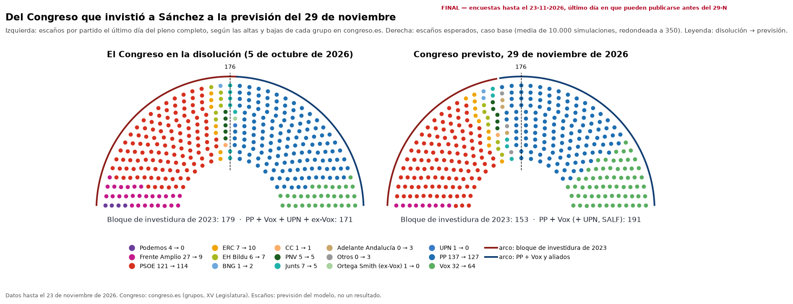
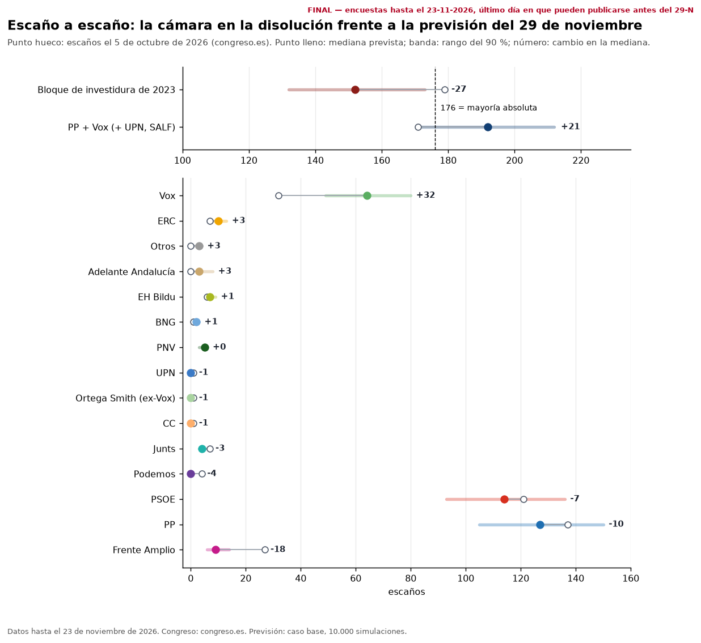
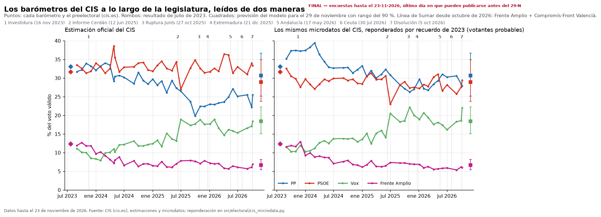

# Del Congreso que invistió a Sánchez al 29-N: comparación escaño a escaño

*English version: [`docs/chamber_29N.md`](../docs/chamber_29N.md).*

> **Previsión, no resultado.** Las cifras del 29-N son las del run final del modelo (encuestas hasta
> el 23-11-2026, caso base con la izquierda en listas separadas, 10.000 simulaciones). La composición
> del Congreso sale de congreso.es. Las explicaciones del «por qué» son interpretación del autor apoyada
> en el CIS, las encuestas y la prensa: no son parte del modelo y no prueban causalidad.

Reproducible con `electoral chamber` (`src/electoral/chamber.py`): descarga las altas y bajas de los
nueve grupos de la XV Legislatura, reconstruye la cámara y la compara con las simulaciones. Tablas en
`outputs/chamber_29n.csv` y `outputs/chamber_blocs_29n.csv`.

## 1. Cómo está organizado el Congreso y de dónde salen los números

- **350 escaños** en 52 circunscripciones (las provincias, más Ceuta y Melilla), repartidos por
  D'Hondt con un umbral del 3 % *en cada provincia*. No hay umbral nacional: un 1,5 % concentrado en
  Cataluña da más escaños que un 6 % repartido por toda España.
- **Grupos parlamentarios** (Reglamento del Congreso, art. 23): hacen falta 15 diputados, o 5 con el
  15 % de los votos en las circunscripciones donde se presentó la lista o el 5 % en toda España. Quien
  no llega va al **Grupo Mixto**. Por eso los grupos no son los partidos: el Mixto de la disolución
  juntaba a Podemos, BNG, CC, UPN, Compromís (Més) y a un exdiputado de Vox.
- **Investidura** (Constitución, art. 99): mayoría absoluta (176) en la primera votación o mayoría
  simple (más síes que noes) en la segunda, 48 horas después. Sánchez fue investido el 16-11-2023 con
  **179 síes frente a 171 noes**.
- **Tras la disolución** (Real Decreto publicado el 6-10-2026), la web oficial solo muestra como
  «composición actual» a los miembros de la Diputación Permanente (PP 54, PSOE 49, Vox 12, Sumar 12,
  ERC, Junts, Bildu, PNV y Mixto 2 cada uno, titulares y suplentes). La cámara completa se reconstruye
  con la pestaña «Altas y bajas» de cada grupo: 426 tramos de pertenencia con fecha de alta y de baja.
  Se cuenta a cada diputado por el **partido de su lista**, no por su grupo. Las dos fotos suman 350 y
  reproducen el 179-171 de la investidura (comprobado en `tests/test_chamber.py`).

### Lo que cambió en la cámara entre la investidura y la disolución

| fecha | cambio | efecto en los grupos |
|---|---|---|
| 5-12-2023 | Los 5 diputados de Podemos dejan el grupo Sumar | Sumar 31 → 26, Mixto 3 → 8 |
| 26-01-2024 | Lilith Verstrynge (Podemos) renuncia; la sustituye la siguiente de la lista de Sumar | Sumar 27, Podemos 4 |
| 27-02-2024 | Ábalos, apartado por el PSOE (caso Koldo), pasa al Mixto | PSOE 120 |
| 24-10-2024 | Errejón renuncia al escaño (le sustituye Sumar) | sin cambio |
| 12/16-06-2025 | Cerdán dimite tras el informe de la UCO y entrega el acta (le sustituye el PSOE) | sin cambio |
| 3-07-2025 | Àgueda Micó (Més-Compromís) deja Sumar por el Mixto | Sumar 26 |
| 27-10-2025 | **Junts rompe el pacto de investidura** en Perpiñán (avalado por el 87 % de su militancia) | el bloque pierde 7 votos en la práctica |
| 28-01-2026 | Ábalos renuncia al acta desde prisión; el escaño vuelve al PSOE (Ana González Herdaro) | PSOE 121 |
| 17-07-2026 | Ortega Smith, expulsado de Vox en marzo, deja el grupo de Vox por el Mixto | Vox 32 |
| 2-10-2026 | PP, Vox, Junts y UPN tumban los decretos de vivienda | |
| 6-10-2026 | Disolución; elecciones el 29-N | |

**En la disolución, por partido:** PP 137, PSOE 121, Vox 32, Sumar/Frente Amplio 27 (26 en el grupo
más Micó), ERC 7, Junts 7, Bildu 6, PNV 5, Podemos 4, BNG 1, CC 1, UPN 1, Ortega Smith (ex-Vox) 1.
El bloque de la investidura seguía sumando **179 sobre el papel**, pero **172 sin Junts**, que desde
octubre de 2025 votaba con la oposición. El Gobierno llevaba un año en minoría efectiva.

***Figura A.*** *Izquierda: el Congreso el 5-10-2026, último día del pleno completo. Derecha: escaños
esperados el 29-N (media de las simulaciones, redondeada a 350). Los arcos marcan el bloque de la
investidura de 2023 y la derecha.*

## 2. El resultado en una frase

**El bloque que invistió a Sánchez pasa de 179 a 152 escaños (90 %: 132-173) y solo llega a 176 en el
3,5 % de las simulaciones. PP + Vox pasan de 171 a 192 (171-212) y llegan a 176 en el 90 %.** Es un
vuelco de unos 25 escaños entre bloques. Pero casi todo ocurre **dentro** de la derecha: Vox dobla
(+32) mientras el PP *pierde* 10. La izquierda estatal (PSOE + Frente Amplio + Podemos) pasa de 152 a
124: la mayor parte de esa caída es el desplome del espacio de Sumar (−18), no del PSOE (−7).

| bloque | investidura 2023 | disolución 2026 | 29-N (mediana, 90 %) | P(≥ 176) |
|---|---|---|---|---|
| Bloque de investidura de 2023 | 179 | 179 | 152 (132-173) | 3,5 % |
| … sin Junts | 172 | 172 | 148 (128-169) | 1,6 % |
| … más Adelante Andalucía | 179 | 179 | 155 (135-176) | 5,7 % |
| PP + Vox (+ UPN, SALF) | 171 | 171 | 192 (171-212) | 90 % |

**La segunda votación no salva al bloque.** Con mayoría simple bastaría con que los síes superasen a
los noes, pero PP + Vox suman 175 o menos solo en el 10 % de las simulaciones, y aun así el bloque de
investidura más Adelante Andalucía los supera solo en el 7 %. Lo que sí desaparece es la alternativa
de un PP sin Vox: PP + Junts + PNV + CC + UPN llega a 176 en el 0,1 % de los casos. Si la derecha
gobierna, gobierna con Vox. La única mayoría sin Vox ni el bloque de 2023 es la gran coalición
PSOE + PP (100 %), que nadie ha planteado.

***Figura B.*** *Escaños en la disolución (punto hueco) frente a la mediana prevista (punto lleno) y su
rango del 90 %. El número es el cambio en la mediana.*

## 3. Qué dicen los barómetros del CIS a lo largo de la legislatura

Todos los barómetros salen directamente de cis.es (`data/processed/cis_studies.csv`), leídos de dos
maneras: la **estimación oficial** y nuestra **reestimación con los mismos microdatos**, ponderando por
el recuerdo de voto de 2023 y quedándonos con quien dice que votará seguro (método en
`src/electoral/cis_microdata.py`). La diferencia importa. En septiembre de 2026 (estudio 3577), la
muestra recordaba un 39,0 % de voto al PSOE en 2023 (real: 31,7 %) y un 24,4 % al PP (real: 33,1 %).
La estimación oficial no corrige ese desequilibrio y por eso pone siempre al PSOE delante.

***Figura C.*** *El CIS barómetro a barómetro, de septiembre de 2023 al preelectoral de noviembre de
2026 (estudio 3584, 45.074 entrevistas).*

| CIS, % voto válido | sep. 2023 (3420) | jul. 2025 (3517) | sep. 2026 (3577) | preelectoral (3584) | 2023 real |
|---|---|---|---|---|---|
| PP: oficial / reestimado | 31,7 / 35,1 | 26,5 / 30,8 | 25,5 / 30,6 | 25,5 / 27,9 | 33,1 |
| PSOE: oficial / reestimado | 33,5 / 32,6 | 27,0 / 23,0 | 31,0 / 25,7 | 33,3 / 29,4 | 31,7 |
| Vox: oficial / reestimado | 11,1 / 11,5 | 18,9 / 20,5 | 16,6 / 18,3 | 18,4 / 22,0 | 12,4 |
| Sumar → Frente Amplio + FV: oficial / reestimado | 11,9 / 11,6 | 7,8 / 7,4 | 5,7 / 5,4 | 6,9 / 6,0 | 12,3 |

Tres fases, legibles en las dos versiones:

1. **Agosto 2023 - mayo 2025: desgaste lento.** El PP reestimado está por encima del 35 % en 2023-24 y
   baja hacia el 31-33 %. Vox sube de forma constante del 11 al 15 %. Sumar se parte en dos tras la
   salida de Podemos y cae del 11-12 % al 6-7 %. El PSOE aguanta en el 28-30 %.
2. **Junio-julio 2025: el caso Cerdán.** Es el único salto brusco de la serie. Tras el informe de la UCO
   (12-06-2025), el PSOE reestimado cae del 30,6 al 23,0 % y Vox sube del 14,1 al 20,5 %. El PSOE se
   recupera en otoño (28-29 %), pero **Vox no vuelve a bajar del 16 %**: el escándalo socialista no
   alimentó al PP, alimentó a Vox.
3. **Octubre 2025 - octubre 2026: sin mayoría.** Ruptura de Junts, derrotas autonómicas (Extremadura,
   Aragón, Andalucía), crisis de Ceuta y decretos tumbados. El PSOE oscila entre el 26 y el 31 %, el PP
   se recupera hasta el 30-31 % a mediados de 2026 y Vox se mueve entre el 16 y el 22 %.

**La lectura brutal:** desde el verano de 2025, ninguna versión del CIS, ni la oficial, ha dado al
bloque de la investidura una ventaja sobre PP + Vox parecida a la de 2023. La oficial mantiene al PSOE
primero porque no pondera por recuerdo; con los mismos datos ponderados, PP y PSOE están empatados en
torno al 28-30 % y Vox está en el 18-22 %. **Lo que decide la mayoría no es quién gana entre PP y PSOE,
es el tamaño de Vox.**

## 4. Partido a partido: cuánto cambia y por qué

Escaños: disolución → previsión del 29-N (mediana, rango del 90 %). Voto: 2023 → previsión.

### Vox: 32 → 64 (49-80), +32. Voto 12,4 % → 18,5 %
- **Por qué sube.** (1) *Corrupción ajena:* el salto de julio de 2025 en el CIS coincide con el caso
  Cerdán, y Vox capitalizó ese castigo más que el PP. (2) *Inmigración:* la crisis de Ceuta (julio de
  2026, unas 72.000 entradas) llevó la inmigración a primer problema en las encuestas privadas (40dB:
  45,9 %). Vox es el partido visto como más competente en el tema (27 %, frente al 18,4 % del PSOE y
  el 13,9 % del PP). (3) *Normalización:* gobierna con el PP en Extremadura y Aragón y dobló su grupo
  en Aragón (14 escaños). (4) *Jóvenes:* en el preelectoral del CIS es primera fuerza en voto directo
  por debajo de los 45 años, y entre los de 18-24 tiene un 22 %, frente al 19 % del PSOE y el 12 % del
  PP.
- **Por qué rinde tantos escaños.** Con un 18 %, Vox saca diputado en casi todas las provincias,
  incluidas las de 3-5 escaños donde en 2023 se quedaba fuera. En noviembre de 2019 un 15,1 % le dio 52.
- **Qué podría desmentirlo.** En la última semana de encuestas Vox bajó (mediana de 18,8 a 18,0) y el
  PSOE subió. La salida de Ortega Smith y su carta contra Abascal no se ven en los datos. Hay una
  incógnita de medición: nuestra reestimación del 3584 da a Vox un 22 % y el promedio un 18,5 %. Si la
  verdad está más cerca del CIS reponderado, el rango alto (80) es plausible.

### PP: 137 → 127 (105-150), −10. Voto 33,1 % → 30,7 %
- **Por qué baja aunque la derecha gana.** Los vasos comunicantes: el PP reestimado pasa del 35-39 % de
  2023-24 al 28-31 % de 2026, y casi todo lo que pierde va a Vox. Feijóo ganó la oposición, pero no
  el bloque. Su petición final a los votantes del PSOE para que le «presten» el voto y no depender de
  Vox reconoce el problema.
- **Lo que le sostiene.** Es primera fuerza en el 71 % de las simulaciones y, con un 30 %, el sistema le
  sigue premiando en las provincias pequeñas. La prensa dio el debate del 19-N a Feijóo, pero las
  encuestas no movieron al PP después.
- **Qué podría desmentirlo.** Un voto útil de la derecha hacia el PP en el último momento. Las
  encuestas no lo muestran: el PP estuvo plano en la última semana.

### PSOE: 121 → 114 (93-136), −7. Voto 31,7 % → 29,0 %
- **Por qué baja.** (1) *Escándalos en cadena:* el caso Koldo/Ábalos (condena del Supremo en septiembre
  de 2026: 24 años para Ábalos), Cerdán y el frente judicial pendiente. (2) *El coste de gobernar en
  minoría:* sin Junts desde octubre de 2025, los decretos de vivienda cayeron el 2-10-2026 y el PSOE
  convocó desde la derrota. (3) *Ciclo autonómico pésimo:* Extremadura 25,8 % (el peor de su
  historia), Aragón 24,4 %, Andalucía 22,8 %. (4) *Gestión:* el accidente de Urda (28-10-2026, 69
  muertos) y la dimisión de Puente en plena precampaña.
- **Por qué no se hunde.** El voto socialista se va a la **abstención**, no al PP: en septiembre, el
  28 % de los indecisos del CIS había votado PSOE en 2023 (el 8,5 % al PP). Eso es recuperable en
  campaña, y en la última semana el PSOE recuperó unos dos puntos (mediana del 26,5 al 28,4 %),
  sobre todo a costa del Frente Amplio y de Vox. La concentración del voto de izquierdas le da escaños
  a costa de sus socios, no del bloque.
- **Qué podría desmentirlo.** 2023: todas las encuestadoras subestimaron al PSOE en unos 5 puntos.
  Nuestro CIS reponderado lo pone primero (29,4 frente a 27,9) y tres encuestadoras (40dB, SW
  Demoscopia, Cluster17) dan empate o ventaja socialista. El rango alto de 136 es ese escenario. Aun
  así, más PSOE a costa de sus socios no cambia la mayoría.

### Sumar → Frente Amplio (+ Compromís-Front Valencià): 27 → 9 (6-14), −18. Voto 12,3 % → 6,7 %
- **El mayor desplome de la cámara.** El espacio que sumaba 31 escaños en 2023 llega roto: Podemos se
  fue en diciembre de 2023, Errejón dimitió en octubre de 2024, Més-Compromís dejó el grupo en 2025,
  Yolanda Díaz se apartó en 2026 y el Frente Amplio es la cuarta marca del espacio en diez años (Colau
  de candidata). El CIS reestimado lo baja del 11,6 % al 6,0 %.
- **Por qué cuesta tantos escaños.** D'Hondt castiga el 6 % nacional: fuera de Madrid, Barcelona,
  Valencia y unas pocas provincias grandes no llega al umbral efectivo. Pasar del 12 al 6,7 % divide
  los escaños por tres, no por dos.
- **Qué podría desmentirlo.** El CIS oficial le da 7-11 escaños al Frente Amplio y 4-6 a Compromís-Front
  Valencià (11-17 juntos), y las encuestadoras 11-15.
  Nuestro modelo hereda la geografía de 2023 y puede quedarse corto con Más Madrid (limitación
  documentada en el README).

### Podemos: 4 → 0 (0-1), −4. Voto 1,4 % donde va solo
- Rompió con Sumar en diciembre de 2023 y llegó a rozar el 5 % en el CIS reestimado (diciembre de 2024),
  pero en el preelectoral está en el 1,1 %. Fracasaron las primarias conjuntas con el Frente Amplio,
  así que va solo en 42 circunscripciones y en coalición en Canarias, la Comunitat Valenciana y
  Baleares. En Cataluña sus candidatos van en las listas de ERC. **Ojo:** si algún candidato de Podemos
  sale elegido dentro de ERC o de Compromís-Front Valencià, el modelo lo cuenta para esos partidos.

### ERC: 7 → 10 (7-13), +3. Voto 1,9 % → 2,6 %
- El CEO (Centre d'Estudis d'Opinió) le daba 10-11 escaños en el Congreso, Rufián es el cuarto líder
  preferido en el CIS de septiembre (4,6 %, por delante de Ayuso y Díaz) y lleva a Podemos en sus listas. El CIS
  codifica «ERC-Podemos» como una sola opción (3,1 %, 10-14 escaños). La previsión es el único
  crecimiento claro dentro del bloque de la investidura: más escaños en el 92 % de las simulaciones.

### Junts: 7 → 4 (3-7), −3. Voto 1,6 % → 1,2 %
- **Rompió con Sánchez** el 27-10-2025 para no dejarse adelantar por Aliança Catalana, que en el CEO
  ya le superaba en intención de voto al Parlament. Votó contra los decretos de vivienda y provocó la
  convocatoria. AC no se presenta el 29-N y cerca de una cuarta parte de sus votantes irían a Junts,
  pero no basta. El juicio del «3 %» empezó el 23-N. Pierde escaños en el 95 % de las simulaciones.
- **Para el bloque, es una pérdida doble:** Junts ya no está en él y además tiene menos escaños.

### PNV: 5 → 5 (3-6), 0 · EH Bildu: 6 → 7 (5-9), +1
- El Sociómetro (abril de 2026) los dejaba casi empatados (PNV 35,3 %, Bildu 32,2 %). La pelea es por el
  último escaño de Bizkaia y Araba, y Bildu suma en Gipuzkoa y Navarra con el voto que deja la
  izquierda estatal. El PNV votó contra el segundo decreto de vivienda: sigue en el bloque, pero menos
  atado a él.

### BNG: 1 → 2 (1-3), +1
- Arrastra la fuerza de las autonómicas gallegas de 2024 (submuestras gallegas del CIS agrupadas, unos
  920 entrevistados). Un segundo escaño, con A Coruña como candidata más probable, sale en el 90 % de las
  simulaciones.

### CC: 1 → 0 (0-1) · UPN: 1 → 0 · Ortega Smith: 1 → 0
- **CC** vive del último escaño de Las Palmas o Santa Cruz de Tenerife con un 0,3-0,5 % nacional: lo
  conserva en el 45 % de las simulaciones. Votó a Feijóo en septiembre de 2023 y a Sánchez en
  noviembre, así que es un voto bisagra más que de bloque.
- **UPN** va en coalición con el PP en Navarra: si saca escaño, el modelo lo cuenta como PP. No es una
  pérdida real para la derecha.
- **Ortega Smith** no aparece en ninguna lista del 29-N en las fuentes consultadas. Su escaño salió de
  la lista de Vox.

### Adelante Andalucía: 0 → 3 (0-8) · Otros (Soria ¡Ya!, Teruel Existe, UPL): 0 → 3 (1-4)
- Adelante Andalucía sacó un 9,6 % en las andaluzas de mayo de 2026 (+6) y el CIS le da 3-4 escaños. No
  votó la investidura de 2023 porque no estaba en el Congreso, pero difícilmente apoyaría a PP + Vox.
  Aun sumándolo, el bloque se queda en 155. Su rango es amplio porque el modelo no lo identifica en el
  agregador (cuota fija repartida por las ocho provincias andaluzas).
- Los «otros» son listas de la España vaciada. Si entran, son los únicos escaños bisagra fuera de los
  bloques.

## 5. Conclusión

1. **El 29-N no se pierde por el PSOE, se pierde por los socios.** El PSOE cede unos 7 escaños. El
   espacio a su izquierda cede 22 (Frente Amplio −18, Podemos −4) y Junts sale del bloque y además
   encoge. La aritmética de 2023, la de Sánchez más seis socios, no existe en el 96 % de las
   simulaciones.
2. **La derecha gana con Vox, no con el PP.** El PP tendría menos escaños que en 2023. La mayoría de
   PP + Vox descansa en que Vox doble su grupo, lo que hace a Vox imprescindible para cualquier
   investidura de Feijóo: sin él, PP + Junts + PNV + CC + UPN llegan a 176 en el 0,1 % de los casos.
3. **El riesgo de esta lectura es el de 2023.** El 5 % de simulaciones más favorable al bloque de la
   izquierda devuelve a la derecha a 171 escaños: exactamente la cifra de 2023. Para eso haría falta un
   error de las encuestas a favor del PSOE de la misma magnitud que el de entonces. No es imposible
   (ocurre en una de cada diez simulaciones), pero no es el escenario central.

## Fuentes

- **Congreso:** composición y altas y bajas de los grupos, XV Legislatura,
  [congreso.es](https://www.congreso.es/es/grupos/composicion-en-la-legislatura) (consultado el
  23-11-2026); descarga reproducible en `src/electoral/chamber.py`.
- **CIS:** barómetros y preelectoral 3584, estimaciones y microdatos de [cis.es](https://www.cis.es)
  (`data/processed/cis_studies.csv`).
- **Cambios en la cámara:** Ortega Smith deja el grupo de Vox
  ([El Español](https://www.elespanol.com/espana/politica/20260717/ortega-smith-anuncia-deja-vox-congreso-pasa-grupo-mixto-no-veo-representado/1003744325225_0.html),
  [Ara](https://en.ara.cat/politics/ortega-smith-leaves-the-vox-parliamentary-group-in-congress-and-moves-to-the-mixed-group_25_5801415.html));
  expulsión en marzo ([El Español](https://www.elespanol.com/espana/politica/20260306/vox-expulsa-definitivamente-ortega-smith-formacion-aparta-jose-angel-antelo-direccion-nacional/1003744158136_0.html));
  Micó al Mixto ([VilaWeb](https://www.vilaweb.cat/noticies/mes-compromis-trenca-sumar-agueda-mico-grup-mixt/),
  [El Independiente](https://www.elindependiente.com/espana/2025/06/24/sumar-distingue-la-salida-de-agueda-mico-al-grupo-mixto-de-la-de-podemos-en-2023-no-es-transfuguismo/));
  Ábalos renuncia al acta ([Público](https://www.publico.es/politica/abalos-renuncia-escano-congreso.html),
  [Noticias de Navarra](https://www.noticiasdenavarra.com/politica/2026/01/28/psoe-recupera-escano-renuncia-abalos-10630708.html));
  Cerdán ([El Salto](https://www.elsaltodiario.com/psoe/santos-cerdan-dimite-todos-cargos-entrega-acta-diputado),
  [Deia](https://www.deia.eus/politica/2025/06/16/santos-cerdan-informa-supremo-dejara-9765500.amp.html));
  ruptura de Junts ([Última Hora](https://www.ultimahora.es/noticias/comunidades/2025/10/27/2499801/ejecutiva-junts-acuerda-por-unanimidad-romper-psoe.html),
  [Ara, consulta a la militancia](https://es.ara.cat/politica/afiliados-junts-avalan-romper-sanchez-87-apoyo_1_5546088.html)).
- **Contexto de campaña, encuestas y estudios regionales (CEO, Sociómetro):** ver
  [`docs/context_29N_2026.md`](../docs/context_29N_2026.md), §1-§9, con sus fuentes.
